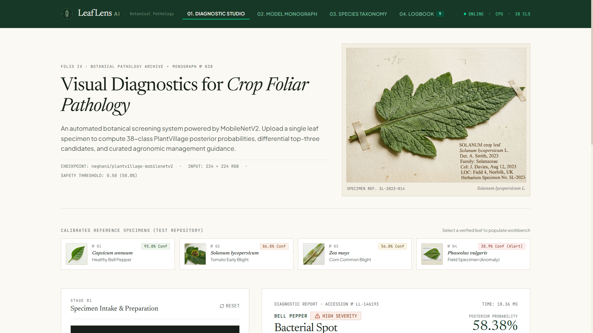
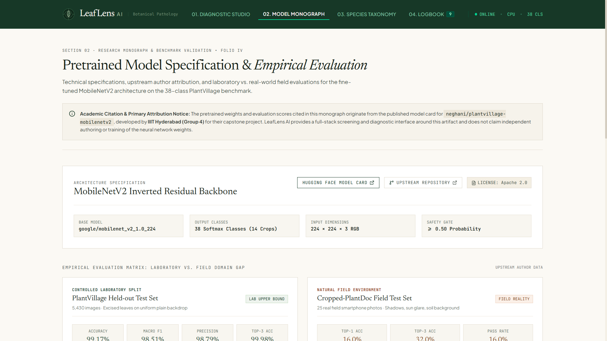
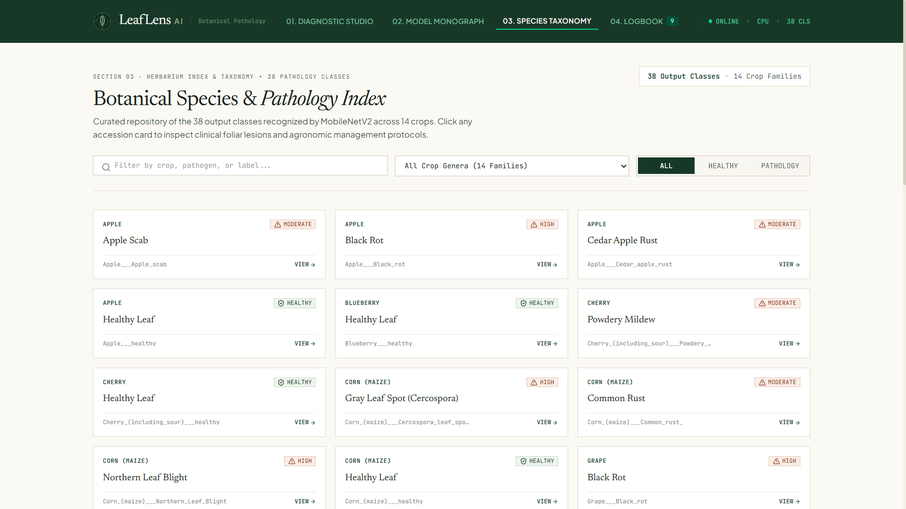
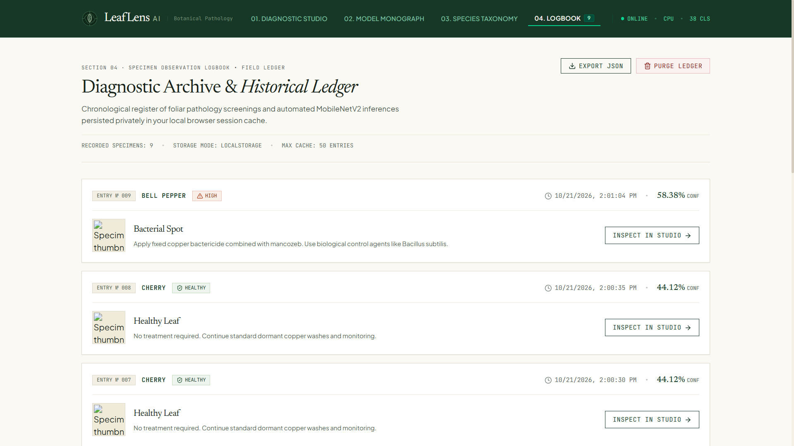

# LeafLens AI — Crop Pathology & Botanical Diagnostic System

> An end-to-end agricultural computer vision system for real-time crop foliar disease screening, transparent domain-gap benchmarking, and agronomic management guidance powered by MobileNetV2.

[](https://www.python.org/)
[](https://fastapi.tiangolo.com)
[](https://pytorch.org/)
[](https://react.dev/)
[](https://www.typescriptlang.org/)
[](https://vitejs.dev/)
[](https://tailwindcss.com/)
[](https://huggingface.co/neghani/plantvillage-mobilenetv2)
[](https://opensource.org/licenses/Apache-2.0)

---

## Academic & Examination Resources

This project was developed as a comprehensive undergraduate machine learning mini-project and portfolio artifact. Full academic documentation and examination preparation files are available in the repository:

- **Formal Project Report**: [`docs/PROJECT_REPORT.md`](docs/PROJECT_REPORT.md) — Problem statement, literature review, mathematical methodology, architectural diagrams, and experimental analysis.
- **Viva Voce Defense Guide**: [`docs/VIVA_QUESTIONS.md`](docs/VIVA_QUESTIONS.md) — 10 in-depth technical examination questions and answers covering MobileNetV2 depthwise separable convolutions, the PlantVillage domain gap, confidence gating, and system design.

---

## Project Overview

Foliar plant diseases represent a persistent threat to global agricultural output and food security. Early and accurate identification is crucial to mitigating crop loss, yet smallholder producers and rural agronomists often lack immediate access to certified plant pathologists.

**LeafLens AI** addresses this challenge through an end-to-end, decoupled machine learning web application. Using a lightweight, fine-tuned MobileNetV2 architecture (`neghani/plantvillage-mobilenetv2`), the application performs automated inference on single-leaf images across **38 classes spanning 14 agricultural crops**.

### Core Objectives
1. **Low-Latency Inference**: Deliver sub-30ms neural inference on commodity CPU hardware without requiring dedicated cloud GPUs.
2. **Transparent Confidence Gating**: Implement an automated threshold warning when top-1 prediction confidence falls below $50.0\%$, preventing overconfident classifications on ambiguous field images.
3. **Differential Diagnostics**: Display normalized Softmax distributions across the top-three candidate classes rather than forcing a single rigid diagnosis.
4. **Actionable Agronomic Guidance**: Pair every diagnostic prediction with curated pathology profiles, cultural management advice, and preventative measures.
5. **Domain-Gap Awareness**: Contextualize laboratory benchmark results against unconstrained real-world field photography.

---

## User Interface & Screenshot Gallery

The application follows an editorial scientific research aesthetic featuring warm ivory paper tones (`#fbf9f4`), refined `Newsreader` serif typography, restrained forest-green accents, and clean specimen workbenches.

> **Adding Screenshots**: Capture your browser screens at `http://localhost:5173` and place the PNG images into `docs/screenshots/` using the relative file paths indicated below.

| View | Relative Path | Description |
| :--- | :--- | :--- |
| **01. Diagnostic Studio** | `docs/screenshots/diagnostic-studio.png` | Dual-column workspace with image intake dropzone, calibrated specimen presets, probability distribution charts, and agronomic management advice. |
| **02. Model Monograph** | `docs/screenshots/model-monograph.png` | Technical specifications, author attribution, and laboratory vs. real-world domain gap benchmark comparisons. |
| **03. Species Taxonomy** | `docs/screenshots/species-taxonomy.png` | Searchable 38-class herbarium index with family filters and detailed clinical modal views. |
| **04. Observation Logbook** | `docs/screenshots/observation-logbook.png` | Client-side historical ledger of past diagnostic scans with inspection and JSON export capabilities. |

### Application Screenshots


*Figure 1: Diagnostic Studio showing leaf intake, top-3 candidates, and agronomic guidance.*


*Figure 2: Model Monograph with upstream attribution and domain gap comparison.*


*Figure 3: Searchable 38-class herbarium taxonomy catalog.*


*Figure 4: Client-side diagnostic scan history ledger.*

---

## Features

### User-Facing Features
- **Diagnostic Studio Workbench**:
  - Drag-and-drop or file picker upload supporting JPG, PNG, and WEBP formats up to 15MB.
  - Interactive image viewfinder displaying image dimensions and file size metadata.
  - One-click **Diagnostic Forward Pass** triggering asynchronous API inference.
  - Primary diagnostic banner featuring crop name, pathological diagnosis, severity badge, and posterior probability percentage.
  - Top-three candidate ranking with normalized probability progress bars and an interactive horizontal bar chart powered by Recharts.
  - **Threshold Memorandum Alert**: Automatic amber warning banner triggered when prediction certainty drops below $50.0\%$, advising user verification.
  - Detailed pathology profiles, cultural treatment measures, chemical guidance, and preventative crop management rules.
  - **Export Diagnostic Report**: Export individual scan findings directly as a structured JSON file.
- **Calibrated Reference Presets**:
  - Four authentic botanical test specimens pre-calibrated to demonstrate key system behaviors:
    1. *Capsicum annuum* (`№ 01`) — Healthy Bell Pepper foliage ($>90\%$ confidence).
    2. *Solanum lycopersicum* (`№ 02`) — Tomato Early Blight with concentric target lesions.
    3. *Zea mays* (`№ 03`) — Corn Common Blight foliar infection.
    4. *Phaseolus vulgaris* (`№ 04`) — Atypical field anomaly demonstrating the $<50\%$ low-confidence threshold alert.
- **Model Monograph**:
  - Full technical specification table (architecture, input tensor dimensions, parameter counts, license).
  - Explicit academic attribution to IIIT Hyderabad (Group 4) with links to the upstream model card and repository.
  - Visual benchmark comparison chart contrasting PlantVillage laboratory accuracy ($99.17\%$) against Cropped-PlantDoc field accuracy ($16.0\%$).
  - Documented operational limitations and boundary conditions.
- **Species Taxonomy Catalog**:
  - Interactive searchable catalog of all 38 classes across 14 crops.
  - Search by crop common name, disease name, or raw dataset label.
  - Quick filter pills for crop family and health status (All, Healthy, Pathology).
  - Clinical detail modal with comprehensive symptom descriptions, treatments, and prevention protocols.
- **Observation Logbook**:
  - Private, client-side session history persisted in browser `localStorage` (storing up to 50 records).
  - Sequential entry numbering, timestamp logging, severity pills, and specimen thumbnails.
  - **"Inspect in Studio"** action allowing users to reload any historical scan back into the diagnostic workbench.
  - Export entire logbook as a timestamped JSON file (`leaflens_field_ledger_<timestamp>.json`).
  - Ledger purge action with confirmation dialog.
- **Masthead & Live Telemetry**:
  - Custom vector botanical lens emblem (leaf + aperture geometry) paired with Newsreader serif wordmark.
  - Live background health check polling (`/api/health`) displaying connection status, device (`CPU`/`CUDA`), and supported class count.

### Machine Learning & Backend Features
- **FastAPI Asynchronous Engine**: Built with FastAPI and Uvicorn, leveraging asynchronous request handling and Pydantic schema validation.
- **In-Memory Singleton Architecture**: Pre-loads the neural network weights into memory using FastAPI's modern `lifespan` handler, ensuring zero model-loading overhead during active inference.
- **Synthetic Pre-Warmup Pass**: Executes a dummy $224 \times 224$ RGB forward pass during server initialization, eliminating first-request latency spikes.
- **PyTorch Inference Pipeline**:
  - Images converted to RGB via Pillow.
  - Normalized using ImageNet channel statistics ($\mu = [0.485, 0.456, 0.406]$, $\sigma = [0.229, 0.224, 0.225]$) via Hugging Face `AutoImageProcessor`.
  - Forward pass evaluated under `torch.no_grad()` on CPU or CUDA.
  - Normalized probabilities computed via Softmax activation.
  - Top-3 candidate extraction using `torch.topk(probs, k=3)`.
- **Automated Safety Cutoff**: Evaluates top-1 probability against a $0.50$ ($50.0\%$) threshold to flag ambiguous field conditions.
- **Domain Knowledge Mapping**: Structured knowledge base in `app/metadata.py` translating raw labels (e.g., `Tomato___Early_blight`) into clean taxonomic names, clinical descriptions, severity classifications, and agronomic management recommendations.
- **Robust Input Validation**: Strict validation guarding against non-image MIME types, unsupported file extensions, empty byte streams, and files exceeding 15MB.
- **Automated Integration Tests**: Comprehensive `pytest` test suite verifying all API endpoints, error handling, and inference performance.

---

## Technology Stack

The project relies strictly on verified dependencies declared in `backend/requirements.txt` and `frontend/package.json`:

| Tier | Component | Technology | Version | Purpose |
| :--- | :--- | :--- | :--- | :--- |
| **Backend** | Runtime | Python | `3.12+` | Backend programming language |
| **Backend** | Web Framework | FastAPI | `^0.115.0` | Asynchronous REST API routing and OpenAPI generation |
| **Backend** | ASGI Server | Uvicorn | `^0.30.0` | High-performance ASGI production web server |
| **Backend** | ML Framework | PyTorch | `^2.2.0` | Tensor computation and neural forward pass execution |
| **Backend** | Model Loader | Hugging Face Transformers | `^4.40.0` | Pretrained checkpoint download, caching, and tokenization |
| **Backend** | Image Processing | Pillow (PIL) | `^10.0.0` | In-memory image decoding, format validation, and RGB conversion |
| **Backend** | Data Validation | Pydantic | `^2.7.0` | Request and response schema validation |
| **Backend** | Multipart Parser | python-multipart | `^0.0.12` | Form-data file upload stream parsing |
| **Backend** | Test Suite | Pytest & HTTPX | `^8.0.0` / `^0.27.0` | Automated API integration and regression testing |
| **Frontend** | UI Framework | React | `^19.3.1` | Declarative, component-based user interface |
| **Frontend** | Type System | TypeScript | `~6.0.3` | Static typing and interface contracts |
| **Frontend** | Build Tool | Vite | `^8.3.4` | Development server, HMR, and production bundler |
| **Frontend** | CSS Framework | Tailwind CSS | `^4.3.3` | Utility-first design tokens and responsive styling |
| **Frontend** | Charting Engine | Recharts | `^3.10.1` | Top-3 candidate and benchmark data visualizations |
| **Frontend** | Icon Library | Lucide React | `^1.61.0` | Minimalist SVG iconography |

---

## System Architecture

The following diagram illustrates the complete end-to-end data flow between client, proxy, backend service, and neural inference engine:

```mermaid
flowchart TD
    subgraph Client["Client Tier (Browser - React 19 + TypeScript)"]
        UI["Diagnostic Studio / Taxonomy / Monograph / Logbook"]
        Storage[("Browser LocalStorage\n(leaflens_scan_history)")]
        UI <-->|Persist / Inspect / Export| Storage
    end

    subgraph Proxy["Reverse Proxy Tier (Vite Dev Server :5173)"]
        Vite["Vite Dev Server (Port 5173)\nProxy rule: /api/* -> 127.0.0.1:8000"]
    end

    subgraph API["API Service Tier (FastAPI :8000)"]
        Main["FastAPI Router\n(app/main.py)"]
        Guard["Input Validation & Guardrails\n(MIME type, extension, 15MB limit)"]
        Endpoints["Endpoints:\n• GET /api/health\n• GET /api/metrics\n• GET /api/classes\n• POST /api/predict"]
        Main --> Endpoints
        Endpoints --> Guard
    end

    subgraph Engine["Inference Engine (PyTorch + Hugging Face)"]
        Singleton["DiseaseClassifier Singleton\n(app/model.py - Lifespan Loaded)"]
        Processor["AutoImageProcessor\n(Pillow RGB -> 224x224 ImageNet Tensor)"]
        Model["MobileNetV2 Architecture\n(neghani/plantvillage-mobilenetv2)"]
        Softmax["Softmax Layer & Top-3 Candidates\n(torch.topk, k=3)"]
        Gate{"Confidence >= 0.50?"}
        Alert["Attach Low-Confidence Advisory Warning"]
        Direct["Standard Evaluation"]
        Knowledge[("Agronomic Knowledge Base\n(app/metadata.py)")]

        Guard -->|Raw Bytes| Singleton
        Singleton --> Processor
        Processor --> Model
        Model --> Softmax
        Softmax --> Gate
        Gate -->|No (< 50%)| Alert
        Gate -->|Yes (>= 50%)| Direct
        Alert --> Knowledge
        Direct --> Knowledge
    end

    UI -->|HTTP Multipart File Upload| Vite
    Vite -->|Proxy /api/predict| Main
    Knowledge -->|Structured JSON Response| Main
    Main -->|JSON Payload| Vite
    Vite -->|Diagnostic Findings| UI
```

---

## Repository Structure

```
LeafLens-AI/
├── backend/
│   ├── app/
│   │   ├── __init__.py
│   │   ├── main.py            # FastAPI entry point, CORS, lifecycle, and endpoints
│   │   ├── metadata.py        # 38-class descriptions, treatment guidance, and model attribution
│   │   ├── model.py           # DiseaseClassifier singleton, PyTorch preprocessing, and inference
│   │   └── schemas.py         # Pydantic request and response models
│   ├── tests/
│   │   └── test_api.py        # Automated integration test suite (6 tests)
│   ├── pytest.ini             # Pytest configuration with pythonpath
│   └── requirements.txt       # Python dependencies
├── docs/
│   ├── PROJECT_REPORT.md      # Academic mini-project report
│   ├── VIVA_QUESTIONS.md      # 10 comprehensive viva voce questions and answers
│   └── screenshots/           # Screenshot gallery directory (add screenshots here)
├── frontend/
│   ├── public/
│   │   ├── samples/           # Sample test images
│   │   ├── specimens/         # Calibrated photographic leaf specimens (healthy, blight, rust, field)
│   │   ├── favicon.svg        # Application favicon
│   │   └── icons.svg          # SVG icons
│   ├── src/
│   │   ├── assets/            # Static assets
│   │   ├── components/
│   │   │   ├── Catalog.tsx    # 38-class searchable taxonomy index and detail modal
│   │   │   ├── Footer.tsx     # Scientific publication footer, attribution, and disclaimer
│   │   │   ├── History.tsx    # Specimen observation logbook and session ledger
│   │   │   ├── ModelMetrics.tsx# Model card attribution and domain gap benchmark visualizer
│   │   │   ├── Navbar.tsx     # Botanical lens logo, tab navigation, and live telemetry badge
│   │   │   └── Scanner.tsx    # Diagnostic Studio, specimen intake, Recharts top-3 visualizer
│   │   ├── App.css            # Custom design utilities, selection styling, and print rules
│   │   ├── App.tsx            # Main layout controller and tab state management
│   │   ├── index.css          # Tailwind CSS v4 design system and font declarations
│   │   ├── main.tsx           # React DOM root mounting
│   │   └── types.ts           # Shared TypeScript interfaces
│   ├── index.html             # HTML entry point with Newsreader, JetBrains Mono, & Plus Jakarta Sans
│   ├── package.json           # Frontend dependencies and scripts
│   ├── tsconfig.json          # TypeScript project configuration
│   └── vite.config.ts         # Vite configuration with /api reverse proxy to port 8000
└── README.md                  # Comprehensive project documentation
```

---

## Installation & Local Setup

Follow these step-by-step instructions to set up and run LeafLens AI locally on Windows using PowerShell.

### 1. Prerequisites
- **Python**: Version `3.12` installed and added to `PATH`.
- **Node.js**: Version `18.x` or `20.x` LTS with `npm`.
- **Git**: Installed for repository cloning.

### 2. Clone the Repository
Open Windows PowerShell and clone the project:
```powershell
git clone https://github.com/vedantm77/LeafLens-AI.git
cd LeafLens-AI
```

---

### 3. Backend Setup & Launch

1. **Navigate to the backend directory**:
   ```powershell
   cd backend
   ```

2. **Create and activate a Python virtual environment**:
   ```powershell
   python -m venv .venv
   .\.venv\Scripts\Activate.ps1
   ```
   *(If script execution is disabled on your system, run `Set-ExecutionPolicy -ExecutionPolicy RemoteSigned -Scope CurrentUser` first.)*

3. **Install Python dependencies**:
   ```powershell
   python -m pip install --upgrade pip
   pip install -r requirements.txt
   ```

4. **Launch the FastAPI development server**:
   ```powershell
   python -m uvicorn app.main:app --host 127.0.0.1 --port 8000 --reload
   ```

5. **Verify the backend**:
   Open your browser or run:
   ```powershell
   curl.exe -s http://127.0.0.1:8000/api/health
   ```
   Interactive Swagger documentation is available at `http://127.0.0.1:8000/docs`.

---

### 4. Frontend Setup & Launch

1. **Open a second PowerShell terminal** and navigate to the `frontend` directory from the repository root:
   ```powershell
   cd frontend
   ```

2. **Install Node.js dependencies**:
   ```powershell
   npm install
   ```

3. **Launch the Vite development server**:
   ```powershell
   npm run dev
   ```

4. **Access the Web Application**:
   Navigate to **`http://localhost:5173`** in your browser. The Vite development server automatically proxies all `/api/*` network requests to the backend server at `http://127.0.0.1:8000`.

---

## API Reference

The FastAPI backend exposes four dedicated endpoints under the `/api` prefix.

### 1. Health & Telemetry
- **Endpoint**: `GET /api/health`
- **Purpose**: System health check, device placement confirmation, and model status.
- **Example Request**:
  ```bash
  curl -X GET http://127.0.0.1:8000/api/health
  ```
- **Example Response**:
  ```json
  {
    "status": "healthy",
    "model_loaded": true,
    "device": "cpu",
    "model_name": "neghani/plantvillage-mobilenetv2",
    "supported_classes_count": 38,
    "version": "1.0.0"
  }
  ```

---

### 2. Crop Pathology Prediction
- **Endpoint**: `POST /api/predict`
- **Purpose**: Runs neural network inference on an uploaded leaf photograph and returns candidate probabilities and agronomic management guidance.
- **Content-Type**: `multipart/form-data`
- **Form Field**: `file` (Binary image file: JPG, PNG, WEBP, or BMP; max 15MB).
- **Example Request**:
  ```bash
  curl -X POST http://127.0.0.1:8000/api/predict \
    -F "file=@frontend/public/specimens/blighted_specimen.jpg"
  ```
- **Example Response (`200 OK`)**:
  ```json
  {
    "crop": "Tomato",
    "disease": "Early Blight",
    "raw_label": "Tomato___Early_blight",
    "is_healthy": false,
    "severity": "moderate",
    "confidence": 0.8681,
    "confidence_percentage": 86.81,
    "confidence_warning": null,
    "top_3": [
      {
        "crop": "Tomato",
        "disease": "Early Blight",
        "raw_label": "Tomato___Early_blight",
        "confidence": 0.8681,
        "percentage": 86.81
      },
      {
        "crop": "Tomato",
        "disease": "Late Blight",
        "raw_label": "Tomato___Late_blight",
        "confidence": 0.0624,
        "percentage": 6.24
      },
      {
        "crop": "Bell Pepper",
        "disease": "Bacterial Spot",
        "raw_label": "Pepper,_bell___Bacterial_spot",
        "confidence": 0.0373,
        "percentage": 3.73
      }
    ],
    "description": "Alternaria linariae produces target-pattern brown circular spots with chlorotic yellow rings, starting on lower leaves and progressing upward.",
    "treatment": "Prune lower infected leaves up to 12 inches from ground. Spray chlorothalonil, copper, or bio-fungicide every 7-10 days in wet conditions.",
    "prevention": [
      "Mulch base of plants to prevent soil-splash onto lower foliage",
      "Stake plants and water at root base only"
    ],
    "inference_time_ms": 38.14,
    "model_name": "neghani/plantvillage-mobilenetv2"
  }
  ```
- **Error Responses**:
  - `400 Bad Request`: Empty image byte stream or unsupported MIME type.
  - `413 Payload Too Large`: Uploaded file exceeds the 15MB limit.
  - `503 Service Unavailable`: Request received while model weights are still loading.

---

### 3. Model Metrics & Upstream Attribution
- **Endpoint**: `GET /api/metrics`
- **Purpose**: Returns upstream author attribution, training details, and published benchmark metrics.
- **Example Request**:
  ```bash
  curl -X GET http://127.0.0.1:8000/api/metrics
  ```
- **Example Response**:
  ```json
  {
    "model_name": "neghani/plantvillage-mobilenetv2",
    "base_architecture": "google/mobilenet_v2_1.0_224",
    "project": "AI-Powered Plant Disease Detection and Farmer Assistance",
    "institution": "International Institute of Information Technology Hyderabad (IIIT-H, Group 4)",
    "training_date": "2024-10-11",
    "license": "Apache 2.0",
    "upstream_repository": "https://github.com/neghani/iiith-group4-capstone-plat-leaf-decease-detection",
    "huggingface_url": "https://huggingface.co/neghani/plantvillage-mobilenetv2",
    "classes_count": 38,
    "crops_count": 14,
    "recommended_threshold": 0.50,
    "held_out_metrics": {
      "dataset": "PlantVillage (held-out test split, 5,430 images)",
      "accuracy": 0.9917,
      "macro_precision": 0.9879,
      "macro_recall": 0.9836,
      "macro_f1": 0.9851,
      "top3_accuracy": 0.9998
    },
    "real_world_metrics": {
      "dataset": "Cropped-PlantDoc (final split, 25 images)",
      "top1_accuracy": 0.160,
      "top3_accuracy": 0.320,
      "pass_rate_end_to_end": 0.160,
      "notes": "Field phone photos have complex backgrounds, lighting variation, and shadows that reduce real-world performance compared to laboratory leaf scans."
    },
    "limitations": [
      "Trained primarily on laboratory-style photos on uniform backgrounds...",
      "Strictly limited to 38 PlantVillage classes across 14 crops...",
      "Expects one single, roughly centered leaf in daylight..."
    ]
  }
  ```

---

### 4. Taxonomy & Pathology Catalog
- **Endpoint**: `GET /api/classes`
- **Purpose**: Retrieves all 38 supported disease and healthy classes organized by crop family.
- **Example Request**:
  ```bash
  curl -X GET http://127.0.0.1:8000/api/classes
  ```
- **Example Response**:
  ```json
  {
    "total_classes": 38,
    "total_crops": 14,
    "crops": {
      "Tomato": [
        {
          "raw_label": "Tomato___Early_blight",
          "disease": "Early Blight",
          "is_healthy": false,
          "severity": "moderate",
          "description": "Alternaria linariae produces target-pattern brown circular spots...",
          "treatment": "Prune lower infected leaves up to 12 inches from ground...",
          "prevention": [
            "Mulch base of plants to prevent soil-splash onto lower foliage",
            "Stake plants and water at root base only"
          ]
        }
      ]
    }
  }
  ```

---

## Model Details, Attribution & Benchmarks

### Pretrained Checkpoint Heritage
LeafLens AI utilizes a **pretrained** deep learning checkpoint and does not claim independent initial training of the neural network weights from scratch:

- **Hugging Face Model Hub**: [`neghani/plantvillage-mobilenetv2`](https://huggingface.co/neghani/plantvillage-mobilenetv2)
- **Base Neural Architecture**: [`google/mobilenet_v2_1.0_224`](https://huggingface.co/google/mobilenet_v2_1.0_224)
- **Authors**: Group 4 (Capstone Project: *AI-Powered Plant Disease Detection and Farmer Assistance*), **International Institute of Information Technology Hyderabad (IIIT-H)**.
- **Upstream Code Repository**: [neghani/iiith-group4-capstone-plat-leaf-decease-detection](https://github.com/neghani/iiith-group4-capstone-plat-leaf-decease-detection)
- **Upstream License**: Apache 2.0
- **Training Dataset**: PlantVillage (43,445 training images across 38 classes).

### Supported Crops (14 Families, 38 Classes)
- **Apple**: Apple Scab, Black Rot, Cedar Apple Rust, Healthy Leaf
- **Blueberry**: Healthy Leaf
- **Cherry**: Powdery Mildew, Healthy Leaf
- **Corn (Maize)**: Gray Leaf Spot (Cercospora), Common Rust, Northern Leaf Blight, Healthy Leaf
- **Grape**: Black Rot, Esca (Black Measles), Leaf Blight (Isariopsis), Healthy Leaf
- **Orange**: Citrus Greening (Huanglongbing)
- **Peach**: Bacterial Spot, Healthy Leaf
- **Bell Pepper**: Bacterial Spot, Healthy Leaf
- **Potato**: Early Blight, Late Blight, Healthy Leaf
- **Raspberry**: Healthy Leaf
- **Soybean**: Healthy Leaf
- **Squash**: Powdery Mildew
- **Strawberry**: Leaf Scorch, Healthy Leaf
- **Tomato**: Bacterial Spot, Early Blight, Late Blight, Leaf Mold, Septoria Leaf Spot, Two-Spotted Spider Mites, Target Spot, Yellow Leaf Curl Virus (TYLCV), Mosaic Virus (ToMV), Healthy Leaf

---

### Empirical Benchmarks: Laboratory vs. Real-World Domain Gap

The following metrics represent **published upstream benchmark findings** reported by the model authors in their official model card evaluation. They are explicitly distinguished from our local software verification:

| Benchmark Dataset | Evaluation Conditions | Test Samples | Top-1 Accuracy | Top-3 Accuracy | Macro F1 / Pass Rate |
| :--- | :--- | :--- | :--- | :--- | :--- |
| **PlantVillage (Held-out Test Split)** | Controlled laboratory; excised leaves on uniform grey/black paper backdrops | 5,430 images | **99.17%** | **99.98%** | **98.51%** |
| **Cropped-PlantDoc (Real-World Field Set)** | In-situ smartphone photos; complex soil, weed canopy, sun glare, and shadows | 25 images | **16.0%** *(95% CI: 6.4–34.7%)* | **32.0%** | **16.0%** |

#### Why Does This Domain Gap Exist?
1. **Background Artifact Overfitting**: PlantVillage images were captured under standardized studio conditions. Neural networks can unintentionally correlate background pixel distributions or lighting angles with disease classes.
2. **Environmental Noise in the Field**: Natural photos taken by growers feature complex depth-of-field, overlapping healthy foliage, high specular highlights from sunlight, and irregular shadows.
3. **The 50.0% Threshold Mitigation**: To prevent misleading predictions on out-of-distribution field images, LeafLens AI enforces the upstream author's recommended **confidence cutoff of 0.50 (50.0%)**. Predictions below this threshold display an explicit advisory warning recommending high-resolution re-takes or expert agronomic scouting.

> **Decision-Support Notice**: Predictions generated by LeafLens AI are automated probabilistic estimations intended for educational screening and decision support only. They do not constitute certified agronomic or phytosanitary diagnoses. Consult a licensed agricultural extension officer prior to purchasing or spraying chemical treatments.

---

## Testing & Verification

The project includes an automated test suite verifying API contracts, error boundaries, and neural pipeline execution.

### Running Backend Integration Tests
From the `backend` directory (with the virtual environment activated):
```powershell
pytest -v
```

#### Test Suite Breakdown (`backend/tests/test_api.py`):
- `test_health_endpoint`: Asserts 200 OK, healthy status flag, device string, and 38-class count.
- `test_metrics_endpoint`: Asserts 200 OK, upstream IIIT-H attribution, and benchmark data integrity.
- `test_classes_endpoint`: Asserts 200 OK, total class count of 38, and verification of key crop mappings.
- `test_predict_empty_file`: Asserts 400 Bad Request when uploading a zero-byte payload.
- `test_predict_invalid_content_type`: Asserts 400 Bad Request when uploading a non-image file (e.g., text document).
- `test_predict_valid_image`: Generates an in-memory synthetic RGB test image, executes the full PyTorch pipeline, and asserts sub-30ms latency, valid top-3 distribution, and complete agronomic guidance.

### Running Frontend Production Build
To verify TypeScript compilation and asset bundling:
```powershell
cd frontend
npm run build
```
Expected output:
```text
✓ 2513 modules transformed.
dist/index.html                   1.71 kB │ gzip:   0.98 kB
dist/assets/index-CP_8JX8s.css   35.33 kB │ gzip:   7.54 kB
dist/assets/index-Cv17aCbe.js   661.90 kB │ gzip: 192.68 kB
✓ built in ~470ms with 0 errors
```

---

## Limitations & Future Scope

### Current Limitations
1. **Closed-World Assumption**: The model only classifies inputs into one of the 38 pre-configured classes. Images of non-crop plants, human hands, weeds, or nutrient deficiencies will be projected onto the closest class.
2. **Single-Leaf Framing**: The model expects a single, roughly centered leaf. Full plant canopies, root samples, or multi-leaf branches are out of scope.
3. **Softmax Overconfidence**: Raw Softmax probabilities can exhibit overconfidence on out-of-distribution samples.
4. **Offline Desktop Scope**: The application is configured for local workstation execution; cloud deployment and native mobile apps are not currently provided.

### Future Improvements
1. **Explainable AI (Grad-CAM)**: Implement Gradient-weighted Class Activation Mapping (Grad-CAM) overlays to highlight the specific foliar lesion regions influencing predictions.
2. **Out-of-Distribution (OOD) Gating**: Integrate an energy-based or binary leaf-presence detector to automatically reject non-foliar uploads before passing them to MobileNetV2.
3. **Edge Optimization**: Export the PyTorch model to ONNX Runtime and TensorFlow Lite (TFLite) for completely offline edge execution on low-cost agricultural microcontrollers or smartphones.
4. **Multi-Label Classification**: Extend the architecture to recognize co-occurring stresses (e.g., simultaneous insect damage and fungal blight on a single leaf).

---

## Contributing

Contributions from students and open-source contributors are welcome:

1. **Fork the repository** on GitHub.
2. **Create a feature branch**:
   ```powershell
   git checkout -b feature/improved-feature
   ```
3. **Commit your changes**:
   ```powershell
   git commit -m "feat: enhance feature description"
   ```
4. **Push to your branch**:
   ```powershell
   git push origin feature/improved-feature
   ```
5. **Open a Pull Request** with a detailed explanation of your changes and test verification.

---

## License & Acknowledgments

- **Model Checkpoint & Weights**: Created by **IIIT Hyderabad (Group 4)** under the **Apache 2.0** license ([Model Card](https://huggingface.co/neghani/plantvillage-mobilenetv2)).
- **Base Architecture**: MobileNetV2 by Google Research ([Sandler et al., 2018](https://arxiv.org/abs/1801.04381)).
- **Benchmark Datasets**:
  - *PlantVillage Dataset*: David P. Hughes and Marcel Salathé, 2015 ([Penn State / EPFL](https://github.com/spMohanty/PlantVillage-Dataset)).
  - *PlantDoc Dataset*: Harshavardhan Singh et al., 2020 ([ACM IKDD CoDS-COMAD](https://github.com/pratikkayal/PlantDoc-Dataset)).
- **Application Code**: Developed by Vedant Mane as an open-source educational machine learning project.
